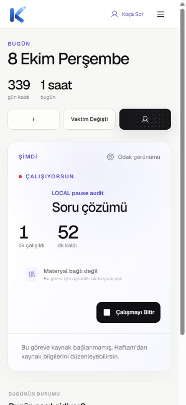
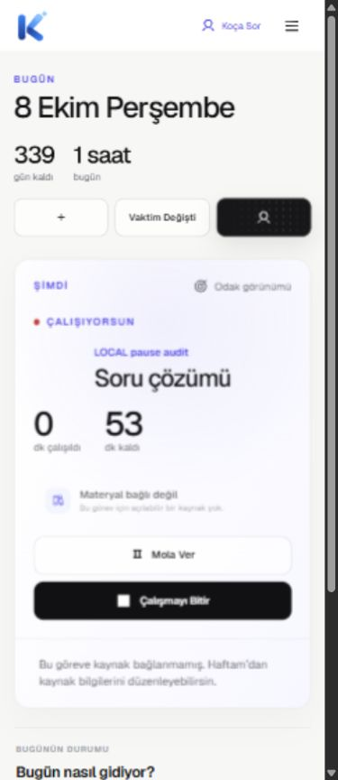
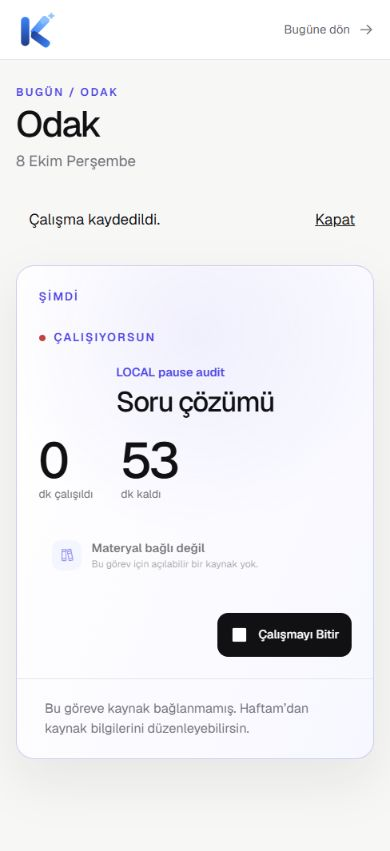
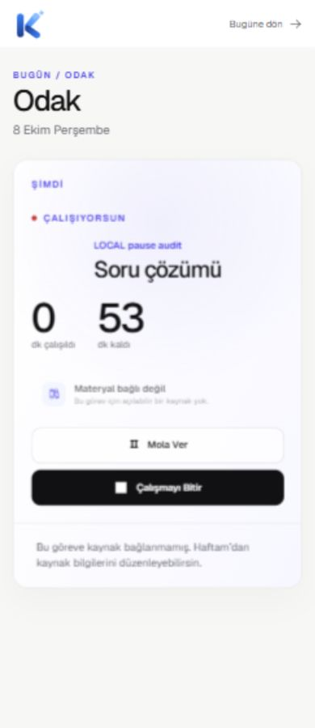

# Mobile session action repair — LOCAL RC record

2026-10-08. **LOCAL repair GREEN; READY FOR NEW RC FREEZE.** Production is not
accepted. This record supplements the existing incident/rollback history;
previous records are unchanged.

Previous RC and authorized parent: `e58e5d7704b95ccf82416904a3f65bce9c5ccb1f`.
The new RC is the local commit containing this record; its exact SHA is recorded
in the ignored post-commit invariant report. Branch: develop; no amend or push.

## Confirmed cause and smallest repair

Classification: **APPLICATION UI DEFECT**. Both Today and Focus use the same
StudyTodayPanel session action group. `.focus-action` directly sets
`grid-column:2; grid-row:3`. These are matched declarations, not CSS inheritance.
At <=760px the action parent becomes grid; <=430px it declares one column.
Both buttons still explicitly occupy column 2, row 3, creating implicit tracks.
They are statically positioned with `z-index:auto`; later sibling Finish paints
over Pause. Desktop uses flex, where grid placement is ignored.

The more specific shared selector now resets all four placement longhands:

```css
.focus-session-actions .focus-action{grid-area:auto;margin-top:0}
```

No per-page workaround, redesign, handler, API, timer or accounting change.
At 320px Windows' 15px scrollbar also exposed a pre-existing `body` minimum of
320px exceeding the 305px layout viewport. `min-width:min(320px,100%)` now caps
that existing minimum by available width. No new overflow-hiding rule was added.

Actual handler mapping remains:

| Control | Handler / request |
|---|---|
| Mola ver | shared `act()` → `POST /study-sessions/{id}/pause` |
| Çalışmaya devam et / Devam Et | same conditional handler → `POST .../resume` |
| Çalışmayı Bitir | `finishActive()` → `POST .../finish` for legacy sessions |

Physical sessions retain their existing pause/dialog/atomic-finish behavior;
this acceptance uses the existing dedicated LOCAL legacy questions fixture.

## Actual browser RED → GREEN

On the old RC layout at actual 390px, both Today and Focus had intersection
area **5888.2998657px²**, identical 133.825×44px controls and computed
`grid-area:3 / 2`. Exact Pause locator count was one and it was visible/enabled.
`elementFromPoint` returned Finish. Native CUA pointer input at Pause's center
generated a trusted Finish click and `POST /finish`, HTTP 200, completed.
This new RED replay used a **synthetic session response**, with zero persisted
sessions. The earlier root-cause audit's real LOCAL evidence remains preserved.

After repair, computed `grid-area:auto`, intersection zero and separate centers
receiving their own controls. The same browser geometry assertion fails on old
evidence and passes on repaired evidence. Native clicks produced the exact
expected receiver, method, endpoint, response and UI state. DOM/contract tests
previously missed occlusion because programmatic clicks bypass hit-testing.

| Actual viewport width | Today | Focus | Overlap / overflow |
|---|---|---|---|
| 320 | PASS | PASS | zero / none |
| 360 | PASS | PASS | zero / none |
| 375 | PASS | PASS | zero / none |
| 390 | PASS | PASS | zero / none |
| 414 | PASS | PASS | zero / none |
| 768 | PASS | PASS | zero / none |
| 1280 | PASS | PASS | zero / none |

14 actual browser viewports, 42 trusted pointer actions (Pause, Resume, Finish
per view), 42 correct HTTP 200 contracts. This matrix uses actual AppShell/UI
and product CSS with mocked session responses; it adds no database sessions.
Persisted backend proof is the separate single-session acceptance below.

| 390px evidence | Old RED | Repaired GREEN |
|---|---|---|
| Today |  |  |
| Focus |  |  |

## One real authenticated LOCAL session

Session: `5fcb3dc5-301b-4270-ae71-91f45f36f896`.
Reused task: `19c01150-747c-4ddd-a08a-0c19d60934b9`; no task was created.

One Start (201) → Today Pause (200, persisted open break, UI Moladasın) → Resume
(200) → normal running reload, same ID → Focus Pause (12s delay) → keyboard
Resume → Focus Pause (12s delay with 30 rapid rerenders **during pending**) →
normal paused reload, same ID/open break → Resume → intentional Focus Finish
(200, completed). All non-keyboard actions used real pointer input; keyboard
Resume was trusted Enter activation and verified independently.

Exactly one added session: 9→10. Tasks remain 6. Three closed breaks added:
12→15. Old nine sessions, old twelve breaks, other five tasks and other progress
rows are unchanged. Only the reused task's update timestamp changed.
Both controls disabled while pending; extra native Pause/Finish input created
no additional POST. No accidental Finish, duplicate transition or duplicate
accounting. The 30 pending refreshes preserved the correct paused UI and separate
targets; the other 30-refresh browser burst and unit tests verify stable control
identity. Running/paused reloads retained the session and paused state.

Wall duration 294.359s minus 129.439s of breaks gives 164.920s of work; existing
backend flooring/minimum yields **2 minutes**. One existing progress row moved
7→9 for both completed and actual minutes. Today total 7→9, week 29→31,
remaining 53→51 minutes. No progress row added. Final active session: none.
Measured Start→Finish console issues and failed network requests: zero.

Raw setup failures are retained: the first proxy evidence writer encountered a
Windows file lock; an early LOCAL Edge restart interrupted fixture GETs; one
Roadmap GET returned 503 before the measured live Start. The fixture matrix was
rerun with captured read models. All final matrix contracts and the measured
real session passed. These infrastructure observations are not attributed to
the CSS patch or hidden as production success.

## Regression and validation

- Full suite: **1555 tests / 206 files PASS**, versus 1548/205 baseline (+7/+1).
- Targeted session/video suite: 50 tests / 5 files PASS. Eleven actual-player
  component tests emulate SDK node replacement and cover A→B, 20 selections,
  loading switches, close/reopen, stale callbacks, StrictMode, slow PUT/backoff,
  checkpoint continuity and Today→Focus. Writer/material/task contracts pass.
  These video checks use the SDK mock; fresh live playback is a future gate.
- New jsdom tests: independent Today/Focus pause/finish contracts, pending
  disabled behavior, 30 rerenders/DOM identity and same paused session remount.
  They supplement, and do not replace, physical browser evidence.
- Typecheck PASS; scoped UX Lab lint 19 files PASS; browser JS syntax checks PASS.
- LOCAL-config build PASS. It is not a production deployment artifact. Prior
  e58 production artifact was archived separately and verified 24/24 unchanged.
- Changed/staged file secret scan and protected surface hashes PASS; no LOCAL
  password, private/server/provider keys or ignored runtime inputs are committed.
- All six authoritative safety scripts PASS: AI Coach, plan preview, AI
  economics, Planning V2 shadow, canonical planner readonly, Coach context readonly.
- `git diff --check` PASS. Source scope: two CSS declarations plus tests/docs.
  Backend/Edge, domain, lockfile, schema/migrations, gates/secrets/config unchanged.

Durable browser runner/assertions: `tests/browser/README.md`.
Sanitized evidence summary: `MOBILE_SESSION_ACTION_FIX_EVIDENCE.json`.
Full LOCAL evidence: ignored `.release/mobile-session-action-fix-20261008/`,
including DOM snapshots, screenshots, journals, state/progress snapshots,
`pointer-regression-result.json`, `session-acceptance-result.json`, full test JSON
and post-commit invariant report. No credentials are in the evidence records.

## Next production acceptance strategy

**Gate A — Video lifecycle (mandatory):** A→B→C, loading switch, close/reopen,
refresh/resume with persisted progress; no blank root, removeChild/NotFoundError,
retired callbacks or duplicate progress writers. Capture SDK lifecycle and
request evidence independently of session automation.

**Gate B — Authenticated session safety (mandatory):** uniquely scoped exact
accessible name, stable DOM identity, enabled/visible state, separate rectangles,
center hit-test and actual trusted receiver. For each action assert expected
method/path, response and persisted state; pause/resume, normal session refresh,
intentional finish and single accounting. Stop before further mutations on
mismatch. A rejected locator or failed test infrastructure is classified as
automation/infrastructure; a correct target whose hit-test reaches another
control is application occlusion. Never infer app regression from selector
failure alone; never waive an observed unsafe session transition.

**Gate C — Additional coverage:** Week, Progress, Roadmap, Coach and broader
mobile navigation. Classify severity/evidence. Cosmetic or optional observation
gaps may be nonblocking; real auth, data, accounting, core navigation or other
release-critical defects still block GO. Gates A **and** B must pass on the new
production RC; local GREEN does not accept production or resurrect old e58.

Recorded production baseline remains web
`b187f696-2bd8-4fc6-b4d8-1e505f2421a9`, app-api v79 ACTIVE, DB unchanged.
No production probe/mutation/deploy occurred in this task. Next: separate new RC
freeze, production-input artifact verification and explicitly authorized release.
